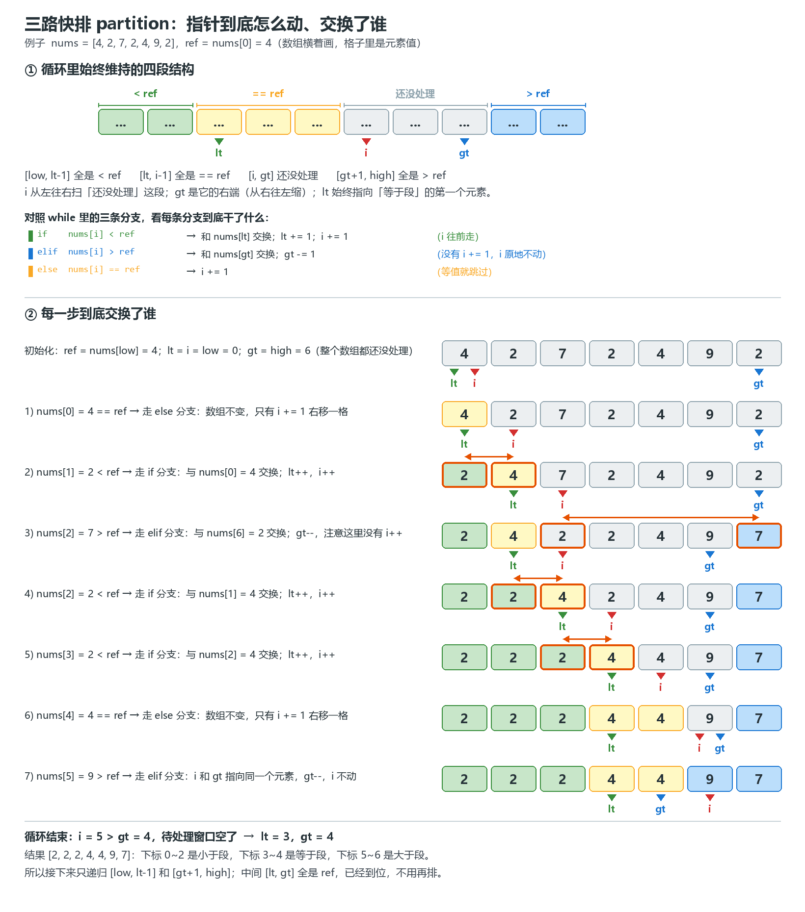
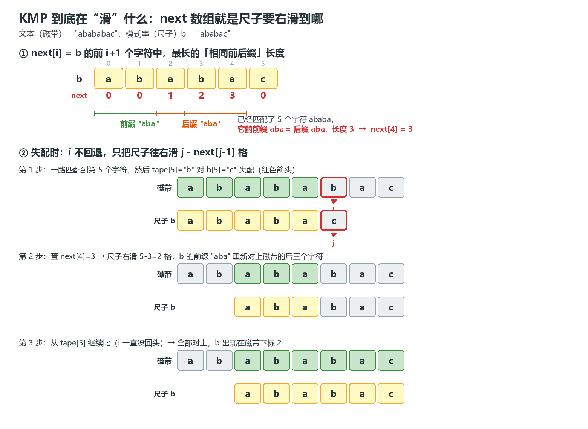
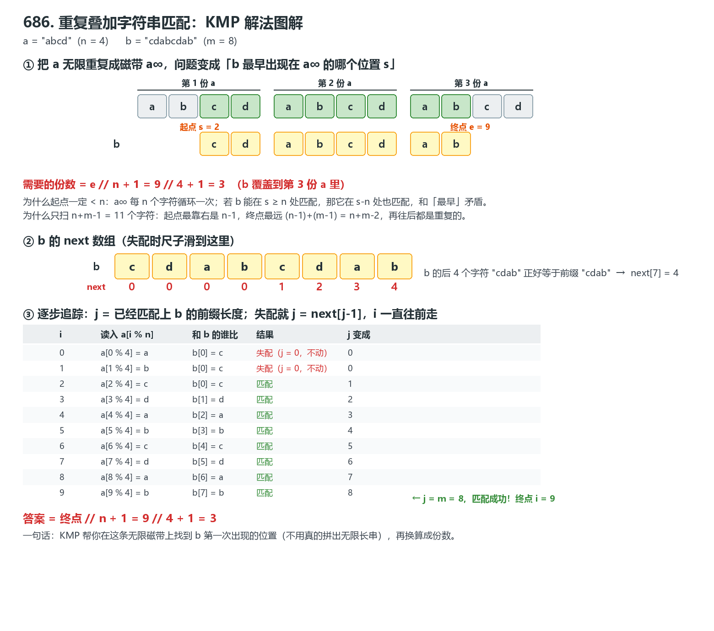

# LeetCode 刷题记录

> 记录题号与代码

记录我的 LeetCode 刷题过程。每道题的代码放在 `solutions/` 目录下，题号与文件一一对应，并按题目记录在下面的索引表里。

- **仓库地址**：<https://github.com/chameleonn4/leetcode->
- **已刷题目**：40 题（简单 21、中等 19，持续更新中）
- **使用语言**：Python3

## 题目索引

| # | 题目 | 难度 | 语言 | 思路 | 代码 | 日期 |
| --- | --- | --- | --- | --- | --- | --- |
| 1 | [两数之和](https://leetcode.cn/problems/two-sum/) | 简单 | Python3 | 哈希表 | [0001-two-sum.py](solutions/0001-two-sum.py) | 2026-10-07 |
| 2 | [两数相加](https://leetcode.cn/problems/add-two-numbers/) | 中等 | Python3 | 哑结点 + 逐位相加 | [0002-add-two-numbers.py](solutions/0002-add-two-numbers.py) | 2026-10-08 |
| 3 | [无重复字符的最长子串](https://leetcode.cn/problems/longest-substring-without-repeating-characters/) | 中等 | Python3 | 滑动窗口 + 哈希表 | [0003-longest-substring-without-repeating-characters.py](solutions/0003-longest-substring-without-repeating-characters.py) | 2026-10-16 |
| 16 | [最接近的三数之和](https://leetcode.cn/problems/3sum-closest/) | 中等 | Python3 | 排序 + 双指针 | [0016-3sum-closest.py](solutions/0016-3sum-closest.py) | 2026-10-08 |
| 20 | [有效的括号](https://leetcode.cn/problems/valid-parentheses/) | 简单 | Python3 | 栈 | [0020-valid-parentheses.py](solutions/0020-valid-parentheses.py) | 2026-10-12 |
| 21 | [合并两个有序链表](https://leetcode.cn/problems/merge-two-sorted-lists/) | 简单 | Python3 | 哑结点 + 尾指针逐个比较 | [0021-merge-two-sorted-lists.py](solutions/0021-merge-two-sorted-lists.py) | 2026-10-29 |
| 26 | [删除有序数组中的重复项](https://leetcode.cn/problems/remove-duplicates-from-sorted-array/) | 简单 | Python3 | 快慢指针 | [0026-remove-duplicates-from-sorted-array.py](solutions/0026-remove-duplicates-from-sorted-array.py) | 2026-10-08 |
| 27 | [移除元素](https://leetcode.cn/problems/remove-element/) | 简单 | Python3 | 快慢指针 | [0027-remove-element.py](solutions/0027-remove-element.py) | 2026-10-08 |
| 28 | [找出字符串中第一个匹配项的下标](https://leetcode.cn/problems/find-the-index-of-the-first-occurrence-in-a-string/) | 简单 | Python3 | 朴素匹配（双指针） | [0028-find-the-index-of-the-first-occurrence-in-a-string.py](solutions/0028-find-the-index-of-the-first-occurrence-in-a-string.py) | 2026-10-10 |
| 36 | [有效的数独](https://leetcode.cn/problems/valid-sudoku/) | 中等 | Python3 | 一遍遍历 + 行/列/宫三个哈希表 | [0036-valid-sudoku.py](solutions/0036-valid-sudoku.py) | 2026-10-20 |
| 45 | [跳跃游戏 II](https://leetcode.cn/problems/jump-game-ii/) | 中等 | Python3 | 贪心 + BFS 分层（end / max_pos） | [0045-jump-game-ii.py](solutions/0045-jump-game-ii.py) | 2026-10-28 |
| 48 | [旋转图像](https://leetcode.cn/problems/rotate-image/) | 中等 | Python3 | 转置 + 翻转每行 | [0048-rotate-image.py](solutions/0048-rotate-image.py) | 2026-10-10 |
| 53 | [最大子数组和](https://leetcode.cn/problems/maximum-subarray/) | 中等 | Python3 | Kadane 动态规划（滚动记录连续和） | [0053-maximum-subarray.py](solutions/0053-maximum-subarray.py) | 2026-10-25 |
| 55 | [跳跃游戏](https://leetcode.cn/problems/jump-game/) | 中等 | Python3 | 贪心（维护能到达的最远位置 far） | [0055-jump-game.py](solutions/0055-jump-game.py) | 2026-10-28 |
| 56 | [合并区间](https://leetcode.cn/problems/merge-intervals/) | 中等 | Python3 | 按左端点排序 + 一次扫描合并 | [0056-merge-intervals.py](solutions/0056-merge-intervals.py) | 2026-10-25 |
| 70 | [爬楼梯](https://leetcode.cn/problems/climbing-stairs/) | 简单 | Python3 | 动态规划（dp[i] = dp[i-1] + dp[i-2]） | [0070-climbing-stairs.py](solutions/0070-climbing-stairs.py) | 2026-10-29 |
| 75 | [颜色分类](https://leetcode.cn/problems/sort-colors/) | 中等 | Python3 | 荷兰国旗三指针（left / right / index） | [0075-sort-colors.py](solutions/0075-sort-colors.py) | 2026-10-28 |
| 88 | [合并两个有序数组](https://leetcode.cn/problems/merge-sorted-array/) | 简单 | Python3 | 双指针 + 临时数组 | [0088-merge-sorted-array.py](solutions/0088-merge-sorted-array.py) | 2026-10-12 |
| 94 | [二叉树的中序遍历](https://leetcode.cn/problems/binary-tree-inorder-traversal/) | 简单 | Python3 | 递归 DFS（左 → 根 → 右） | [0094-binary-tree-inorder-traversal.py](solutions/0094-binary-tree-inorder-traversal.py) | 2026-10-25 |
| 104 | [二叉树的最大深度](https://leetcode.cn/problems/maximum-depth-of-binary-tree/) | 简单 | Python3 | 递归 DFS（左右取较大 +1） | [0104-maximum-depth-of-binary-tree.py](solutions/0104-maximum-depth-of-binary-tree.py) | 2026-10-20 |
| 118 | [杨辉三角](https://leetcode.cn/problems/pascals-triangle/) | 简单 | Python3 | 二维 DP（首尾置 1，中间是左上+右上） | [0118-pascals-triangle.py](solutions/0118-pascals-triangle.py) | 2026-10-29 |
| 121 | [买卖股票的最佳时机](https://leetcode.cn/problems/best-time-to-buy-and-sell-stock/) | 简单 | Python3 | 一次遍历维护历史最低价 | [0121-best-time-to-buy-and-sell-stock.py](solutions/0121-best-time-to-buy-and-sell-stock.py) | 2026-10-27 |
| 136 | [只出现一次的数字](https://leetcode.cn/problems/single-number/) | 简单 | Python3 | 异或（成对的数互相抵消） | [0136-single-number.py](solutions/0136-single-number.py) | 2026-10-28 |
| 141 | [环形链表](https://leetcode.cn/problems/linked-list-cycle/) | 简单 | Python3 | 哈希表记录访问过的结点 | [0141-linked-list-cycle.py](solutions/0141-linked-list-cycle.py) | 2026-10-29 |
| 155 | [最小栈](https://leetcode.cn/problems/min-stack/) | 中等 | Python3 | 辅助栈（同步记录当前最小值） | [0155-min-stack.py](solutions/0155-min-stack.py) | 2026-10-25 |
| 169 | [多数元素](https://leetcode.cn/problems/majority-element/) | 简单 | Python3 | 哈希表计数（过半立即返回） | [0169-majority-element.py](solutions/0169-majority-element.py) | 2026-10-28 |
| 189 | [轮转数组](https://leetcode.cn/problems/rotate-array/) | 中等 | Python3 | 三次反转（整体 + 前 k + 后 n-k） | [0189-rotate-array.py](solutions/0189-rotate-array.py) | 2026-10-25 |
| 219 | [存在重复元素 II](https://leetcode.cn/problems/contains-duplicate-ii/) | 简单 | Python3 | 哈希表维护长度 k 的滑动窗口 | [0219-contains-duplicate-ii.py](solutions/0219-contains-duplicate-ii.py) | 2026-10-20 |
| 234 | [回文链表](https://leetcode.cn/problems/palindrome-linked-list/) | 简单 | Python3 | 转数组后首尾比较 | [0234-palindrome-linked-list.py](solutions/0234-palindrome-linked-list.py) | 2026-10-12 |
| 238 | [除了自身以外数组的乘积](https://leetcode.cn/problems/product-of-array-except-self/) | 中等 | Python3 | 前缀积 × 后缀积（禁用除法） | [0238-product-of-array-except-self.py](solutions/0238-product-of-array-except-self.py) | 2026-10-29 |
| 349 | [两个数组的交集](https://leetcode.cn/problems/intersection-of-two-arrays/) | 简单 | Python3 | 排序 + 双指针（利用有序天然去重） | [0349-intersection-of-two-arrays.py](solutions/0349-intersection-of-two-arrays.py) | 2026-10-16 |
| 394 | [字符串解码](https://leetcode.cn/problems/decode-string/) | 中等 | Python3 | 双栈（外层字符串 + 重复次数） | [0394-decode-string.py](solutions/0394-decode-string.py) | 2026-10-27 |
| 455 | [分发饼干](https://leetcode.cn/problems/assign-cookies/) | 简单 | Python3 | 贪心 + 双指针（小饼干喂小胃口） | [0455-assign-cookies.py](solutions/0455-assign-cookies.py) | 2026-10-20 |
| 509 | [斐波那契数](https://leetcode.cn/problems/fibonacci-number/) | 简单 | Python3 | 按定义递归（进阶可改迭代） | [0509-fibonacci-number.py](solutions/0509-fibonacci-number.py) | 2026-10-20 |
| 622 | [设计循环队列](https://leetcode.cn/problems/design-circular-queue/) | 中等 | Python3 | 多开一格 + 取模区分空/满 | [0622-design-circular-queue.py](solutions/0622-design-circular-queue.py) | 2026-10-12 |
| 686 | [重复叠加字符串匹配](https://leetcode.cn/problems/repeated-string-match/) | 中等 | Python3 | KMP 跑在 a 的无限重复串上（[图解](notes/0686-KMP回退原理图解.png)、[笔记](#686-重复叠加字符串匹配--kmp-在无限重复串上匹配)） | [0686-repeated-string-match.py](solutions/0686-repeated-string-match.py) | 2026-10-12 |
| 739 | [每日温度](https://leetcode.cn/problems/daily-temperatures/) | 中等 | Python3 | 单调递减栈（存还没等到更高温度的下标） | [0739-daily-temperatures.py](solutions/0739-daily-temperatures.py) | 2026-10-25 |
| 763 | [划分字母区间](https://leetcode.cn/problems/partition-labels/) | 中等 | Python3 | 贪心（记录每个字母最后出现的位置） | [0763-partition-labels.py](solutions/0763-partition-labels.py) | 2026-10-28 |
| 912 | [排序数组](https://leetcode.cn/problems/sort-array/) | 中等 | Python3 | 随机基准 + 三路快排（[图解](notes/0912-三路快排分区图解.png)、[笔记](#912-排序数组--三路快排的分区过程)） | [0912-sort-array.py](solutions/0912-sort-array.py) | 2026-10-10 |
| 1122 | [数组的相对排序](https://leetcode.cn/problems/relative-sort-array/) | 简单 | Python3 | 计数排序（下标即值，剩余自动升序） | [1122-relative-sort-array.py](solutions/1122-relative-sort-array.py) | 2026-10-16 |

## 题解笔记

### 912. 排序数组 —— 三路快排的分区过程



一次分区把数组切成四段，`lt` / `i` / `gt` 三个指针分别卡在边界上：

| 指针 | 含义 |
| --- | --- |
| `lt` | 等于段的左边界：`[low, lt-1]` 全部 `< ref` |
| `i` | 当前扫描位置：`[lt, i-1]` 全部 `== ref` |
| `gt` | 大于段的左边界 - 1：`[i, gt]` 还没处理，`[gt+1, high]` 全部 `> ref` |

循环里三条分支的关键区别：

- `nums[i] < ref`：和 `nums[lt]` 交换，`lt++` 且 **`i++`** —— 从等于段换过来的元素一定是 `ref`，已经就位，不用再看；
- `nums[i] > ref`：和 `nums[gt]` 交换，`gt--`，**`i` 不动** —— 从待处理区换过来的是没见过的元素，下一轮必须重新判断；
- `nums[i] == ref`：`i++` —— 元素本来就该待在中间。

循环结束时 `[lt, gt]` 正好圈住整个等于段，所以只需要递归 `[low, lt-1]` 和 `[gt+1, high]`。等于段的元素一次分区就全部归位，这正是重复元素极多时三路快排不会退化成 O(n²) 的原因。

### 686. 重复叠加字符串匹配 —— KMP 在无限重复串上匹配





把 `a` 无限重复看成一条磁带 a∞，题目就变成「`b` 最早出现在 a∞ 的哪个位置 `s`」，答案 `= (s + m - 1) // n + 1`。

两个把"无限"变"有限"的结论：

- **起点一定 `< n`**：a∞ 的周期是 `n`。若 `b` 能在 `s ≥ n` 处匹配，把整个匹配左移 `n` 格也成立，与「`s` 最早」矛盾，所以起点只可能在前 `n` 个位置里；
- **只需要扫 `n + m - 1` 个字符**：起点最右是 `n-1`，`b` 长 `m`，终点最远 `(n-1) + (m-1) = n+m-2`。第 `i` 个字符直接取 `a[i % n]`，不用真的拼出无限长串。

KMP 在这里的角色：`i` 扫磁带（只增不减），`j` = 已经匹配上 `b` 的前缀长度。失配时 `j = next[j-1]`，相当于把尺子 `b` 往右滑 `j - next[j-1]` 格，让「`b` 的前缀」重新对上「刚匹配过的后缀」，而不是把尺子退回起点。

> ⚠️ 一个容易踩的坑：`generate_next` 里的回退必须是 `while`，**不能写成 `if`**——回退一次之后 `p[left]` 可能还是不等于 `p[right]`，得连续回退。
> 用 `if` 只回退一次，算出来的 `next` 数组不符合定义（例如 `"aaaba"` 会得到 `[0,1,2,1,2]`，标准是 `[0,1,2,0,1]`）。
> 本题因为 `kmp` 失配处用的也是 `while`，偏大的 `next` 会被继续回退"纠正"过来，结果侥幸正确；但换到别的 KMP 题就会出错。代码里已修正，并在那一行加了注释提醒。

### 53. 最大子数组和 —— Kadane 算法的两个细节

`cur_sum` 始终表示「以当前元素结尾的最大子数组和」，`max_sum` 是一路见过的最大值。每来一个新元素只有两种选择：接在前面那段后面（`cur_sum + num`），或者自己另起一段（`num`），取大的那个——等价于「前面那段和为负就丢掉」。

两个坑：

- **初值不能用 0，要用 `nums[0]`**。全负数组（如 `[-3,-1,-2]`）的答案是 `-1`，若把 `max_sum` 初始化成 0 就会答成 0；
- **不需要 DP 数组**。`cur_sum` 只依赖上一个值，所以两个变量就够，空间 O(1)。

### 189. 轮转数组 —— 三次反转为什么等价于右移 k 位

把数组看成两段 `A + B`，其中 `A` 长 `n-k`（前 n-k 个元素），`B` 长 `k`（后 k 个元素）。**右移 k 位 = 把 `B` 挪到 `A` 前面 = `B + A`**。三次反转正好完成这件事：

| 步骤 | 操作 | 数组变成 |
| --- | --- | --- |
| 初始 | — | `A + B` |
| ① | 整体反转 | `reverse(B) + reverse(A)` |
| ② | 反转前 k 个（正好是 `reverse(B)`） | `B + reverse(A)` |
| ③ | 反转后 n-k 个（正好是 `reverse(A)`） | `B + A` ✅ |

以样例 `nums=[1,2,3,4,5,6,7], k=3`（`A=[1,2,3,4]`, `B=[5,6,7]`）手推一遍：`[1..7]` → ①`[7,6,5,4,3,2,1]` → ②`[5,6,7,4,3,2,1]` → ③`[5,6,7,1,2,3,4]`。

两个提醒：

- **`k` 必须先对 `n` 取模**，题目里 `k` 最大到 `10^5`，不取模会越界；
- **用左移还是右移，别搞混方向**。左移 k 位 = 右移 n-k 位，如果想用「前 k 个」这套写法算左移，就得先把 `k` 换成 `n-k`（或直接写成「反转前 n-k 个、再反转后 k 个」）。写完最好用手推样例验证一遍方向。

### 739. 每日温度 —— 单调栈：把「谁还在等更高温度」记下来

栈里存的是**还没等到更高温度的那些天的下标**，且它们对应的温度从栈底到栈顶单调不增。

遍历到第 `i` 天时：

- 只要 `temperatures[i] > temperatures[stack[-1]]`，说明栈顶那天终于等到了更高的一天，答案是 `i - stack[-1]`，弹出并写进 `res`；
- 重复这个过程，直到栈空或者栈顶那天的温度不低于今天；
- 把 `i` 压进栈。

**为什么栈里温度能保持单调不增？** 因为栈顶那天若温度 ≥ 今天，它就还得继续等；而它入栈前更靠下的那些天温度更高，早就出栈了。每个下标最多入栈、出栈各一次，所以总时间是 O(n)，不是 O(n²)。

两个细节：

- 遍历结束仍在栈中的日子没等到更高温度，`res` 保持初值 `0`（题目要求用 0 代替）；
- 比较用严格大于 `>` 而不是 `>=`——**温度相等不算「更高」**。

### 155. 最小栈 —— 用辅助栈记住「历史最小值」

`stack` 存原始元素，`minstack` 与它等长，第 `i` 个位置存的是「前 `i+1` 个元素推入之后的最小值」：

- `push` 时压入 `min(val, minstack[-1])`；
- `pop` 时两个栈**同步弹出**——最小值的历史就自然回退到了上一个时刻，不用额外记录；
- `top` 取 `stack` 栈顶，`getMin` 取 `minstack` 栈顶。

这就是「用空间换时间」：四个操作都是 O(1)，代价是多存一份栈。

面试常追问的变体：

- **单栈存元组**：只用一个栈，每个元素存 `(值, 当时的最小值)`，pop 时同时丢掉元组；
- **辅助栈只存「破纪录」的元素**：只有新值 ≤ 当前最小值时才压进辅助栈，空间最省（严格递增序列时辅助栈大小为 1）。

### 394. 字符串解码 —— 双栈：把「外层已解出的串」和「重复次数」分开存

`res` 表示「当前这一层括号里已经解出来的字符串」，`num` 表示正在读取的重复次数。四种字符分别处理：

| 字符 | 动作 |
| --- | --- |
| 数字 | `num = num * 10 + int(ch)`——重复次数可能有多位，必须乘 10 累加 |
| `[` | 把外层的 `res` 和 `num` 分别压进两个栈，然后 `res = ""`、`num = 0`，从新的一层重新拼 |
| `]` | 弹出外层的 `res` 和次数，把本层 `res` 重复 `cur_num` 次再拼回外层：`res = cur_res + res * cur_num` |
| 字母 | `res += ch` |

关键在 `]` 那一行：**先算本层的 `res * cur_num`，再拼到外层前面**——`cur_res + res * cur_num` 的顺序不能反，反了就变成把外层重复一遍。

两个栈也可以合成一个（每次同时压入 `(res, num)` 元组），本质是「保存外层状态，等内层算完再合并回去」。

复杂度：时间 O(输出串长 L)（每个字符至少被拼接一次），空间 O(L + 嵌套深度)。

### 121. 买卖股票的最佳时机 —— 一次遍历维护历史最低价

两个变量：`minprice`（到当前为止的最低买入价）和 `maxprofit`（到当前为止的最大利润）。每个 `price` 来了：比 `minprice` 低就更新买入价；否则算 `price - minprice` 当作今天的卖出利润，比 `maxprofit` 大就更新。

因为 `minprice` 只统计到**当前这一天之前**的价格，所以天然满足「先买后卖」，不会出现把后面的低价当买入价去套前面的高价。

> ⚠️ 本题代码里 `minprice = 10010` 是个**魔数哨兵**，它假设 `prices[i] <= 10^4`（LeetCode 121 的约束确实是 `0 <= prices[i] <= 10^4`），所以能通过、也对拍无误（约束内 4 万组随机零错误）。
> 但实测把价格生成到 10011~20000 时**答案 100% 错**：哨兵比所有价格都小，`minprice` 永远不会被更新，等于把 `10010` 当成了买入价。
> 更稳的写法是 `minprice = float('inf')`，与价格范围无关（已在 ±10^5 上对拍通过）。

## 目录结构

```
leetcode-/
├── README.md                  # 本文件：题目索引 + 题解笔记 + 上传流程
├── .gitignore                 # 忽略 __pycache__ 等无关文件
├── notes/                     # 题解笔记、手画/生成的图解
│   ├── 0686-KMP回退原理图解.png
│   ├── 0686-重复叠加字符串匹配图解.png
│   └── 0912-三路快排分区图解.png
└── solutions/                 # 所有题解代码
    ├── 0001-two-sum.py
    ├── 0002-add-two-numbers.py
    ├── 0003-longest-substring-without-repeating-characters.py
    ├── 0016-3sum-closest.py
    ├── 0020-valid-parentheses.py
    ├── 0021-merge-two-sorted-lists.py
    ├── 0026-remove-duplicates-from-sorted-array.py
    ├── 0027-remove-element.py
    ├── 0028-find-the-index-of-the-first-occurrence-in-a-string.py
    ├── 0036-valid-sudoku.py
    ├── 0045-jump-game-ii.py
    ├── 0048-rotate-image.py
    ├── 0053-maximum-subarray.py
    ├── 0055-jump-game.py
    ├── 0056-merge-intervals.py
    ├── 0070-climbing-stairs.py
    ├── 0075-sort-colors.py
    ├── 0088-merge-sorted-array.py
    ├── 0094-binary-tree-inorder-traversal.py
    ├── 0104-maximum-depth-of-binary-tree.py
    ├── 0118-pascals-triangle.py
    ├── 0121-best-time-to-buy-and-sell-stock.py
    ├── 0136-single-number.py
    ├── 0141-linked-list-cycle.py
    ├── 0155-min-stack.py
    ├── 0169-majority-element.py
    ├── 0189-rotate-array.py
    ├── 0219-contains-duplicate-ii.py
    ├── 0234-palindrome-linked-list.py
    ├── 0238-product-of-array-except-self.py
    ├── 0349-intersection-of-two-arrays.py
    ├── 0394-decode-string.py
    ├── 0455-assign-cookies.py
    ├── 0509-fibonacci-number.py
    ├── 0622-design-circular-queue.py
    ├── 0686-repeated-string-match.py
    ├── 0739-daily-temperatures.py
    ├── 0763-partition-labels.py
    ├── 0912-sort-array.py
    └── 1122-relative-sort-array.py
```

## 文件命名规范

`solutions/题号-题目英文名.py`

- 题号补零到 4 位（例如第 1 题写 `0001`），这样按文件名排序就是按题号排序；
- 题目英文名全小写、单词之间用 `-` 连接，例如 `0001-two-sum.py`、`0002-add-two-numbers.py`。

图解、笔记等非代码文件放在 `notes/` 下，命名 `题号-说明.png`，并在 README 的「题解笔记」里内嵌引用。

## 每做完一题，如何上传（三步）

1. 把新代码存成 `solutions/题号-题目英文名.py`。文件开头用几行注释写上「思路 + 复杂度」当题解（可参考已有文件），本地自测代码可加可不加。
2. 在本文件（README.md）的「题目索引」表格里**新增一行**，填上题号、题目、难度、语言、思路、代码文件链接和日期。
3. 打开 PowerShell，执行下面三条命令：

```powershell
cd D:\leetcode刷题记录
git add .
git commit -m "add 2, 16, 26. 三题"
git push
```

`git commit -m` 后面的说明按当前这道题填写即可。

> 提示：如果 `git push` 报 `Failed to connect to github.com port 443`，一般是本机直连 GitHub 被重置。打开 Clash 后执行 `git config --global http.https://github.com.proxy http://127.0.0.1:7890` 再 push；不需要代理时用 `git config --global --unset http.https://github.com.proxy` 恢复直连。GitHub 的登录凭证已保存在 Windows 凭据管理器（`git:https://github.com`）里，正常情况下不会再要求登录。

## 本地运行某一题

```powershell
cd D:\leetcode刷题记录
python solutions\0026-remove-duplicates-from-sorted-array.py
```

（题解文件只包含 `Solution` 类和注释，直接运行不会有输出；想自查可以在 LeetCode 网页上点「运行」，或临时补一段自测。）
